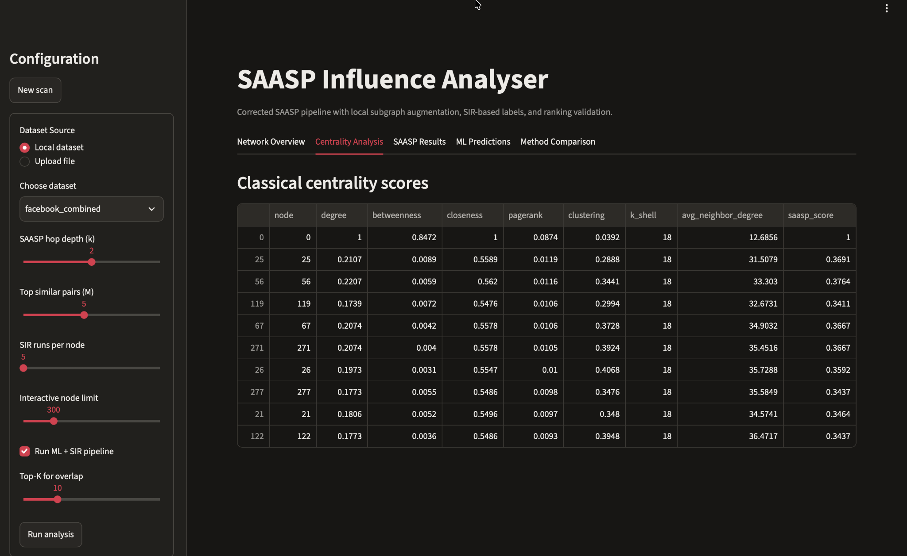
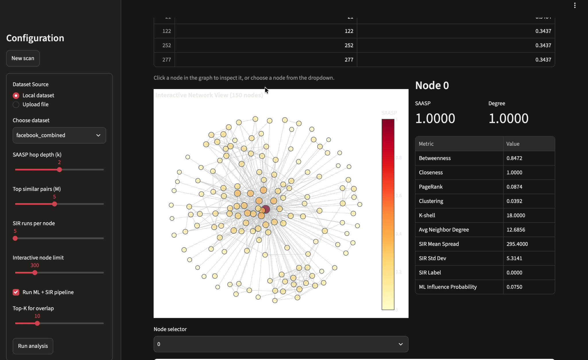
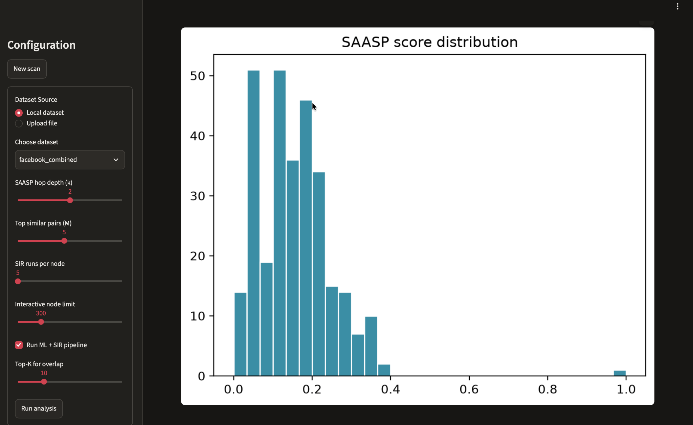
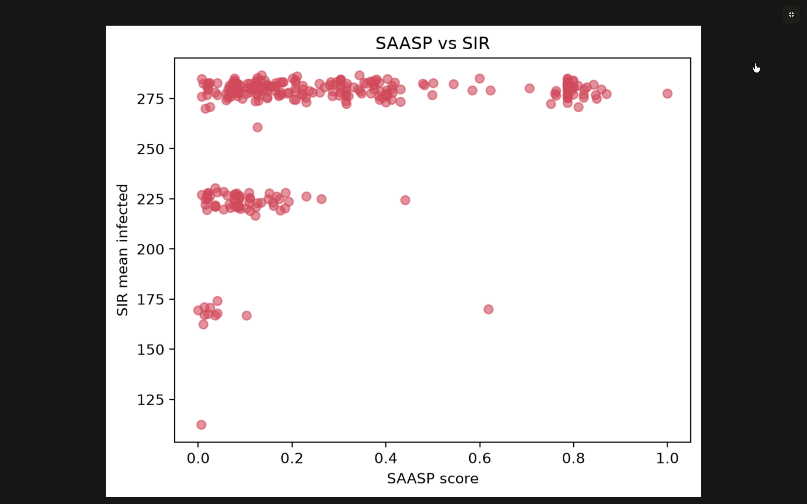
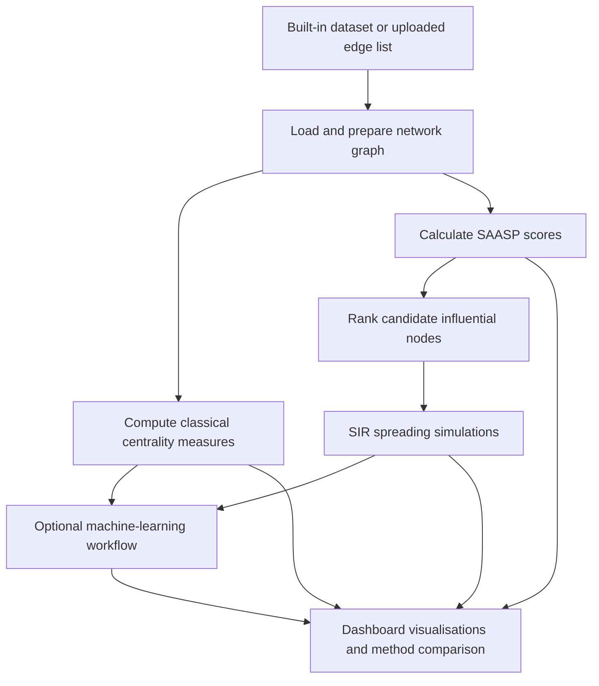

# SAASP Influence Analyzer

An interactive research dashboard for exploring influential nodes in complex networks through graph centrality, SAASP ranking, SIR spreading simulations and machine-learning predictions.

<p>
  <a href="https://github.com/anshif20022kt/Influential-Node-Detection-in-Complex-Networks"><strong>View source code</strong></a>
</p>



## Overview

SAASP Influence Analyzer is a Streamlit application for investigating node influence in complex network datasets. It brings together the project's SAASP implementation, classical centrality measures, SIR-based spread evaluation and an optional machine-learning workflow in a single interactive interface.

The project uses the term **Shortest-path Augmented Adaptive Subgraph Propagation (SAASP)** in its current repository documentation. The dashboard is intended for experimentation, inspection and comparison of node rankings rather than as a universal measure of influence across every network.

## What you can explore

- **Network overview:** Inspect network size, node and edge counts, degree distributions and a graph preview.
- **Multiple data inputs:** Select an included local network dataset or upload an edge-list file.
- **Centrality analysis:** Review degree, betweenness, closeness, PageRank, clustering, k-shell and average-neighbour-degree measures alongside the SAASP score.
- **SAASP ranking:** Identify top-ranked nodes and inspect their scores.
- **Interactive node inspection:** Select a node from the network visualisation or selector and review its metric profile.
- **SIR-based evaluation:** Run spreading simulations and examine mean spread and variability for candidate influential nodes.
- **Machine-learning predictions:** Enable the ML workflow to generate influence probabilities from the computed network features and simulation-derived labels.
- **Method comparison:** Compare ranking methods using rank-correlation statistics and top-K overlap against SIR-based spread results.
- **Experiment controls:** Configure SAASP hop depth, similar-pair count, SIR runs, interactive node limit and top-K overlap settings.

## Dashboard previews

### Centrality analysis


### Interactive network and node inspection



### SAASP score distribution



### SAASP and SIR comparison



## Analysis workflow



## Included datasets

The repository includes the following edge-list datasets:

- `facebook_combined.txt`
- `email-Eu-core.txt`
- `CA-GrQc.txt`

The dashboard also supports selecting an uploaded edge-list file. Check the application's input controls and expected file format before using a custom dataset.

## Technology stack

| Technology | Role |
|---|---|
| Python | Application and analysis logic |
| Streamlit | Interactive web dashboard |
| NetworkX | Network graph operations and centrality analysis |
| NumPy | Numerical operations |
| Pandas | Results tables and data processing |
| SciPy | Statistical ranking comparisons |
| scikit-learn | Machine-learning workflow |
| Plotly | Interactive network and analytical charts |
| Matplotlib | Static graph and distribution visualisations |

## Run locally

### 1. Clone the repository and install dependencies

```bash
git clone https://github.com/anshif20022kt/Influential-Node-Detection-in-Complex-Networks.git
cd Influential-Node-Detection-in-Complex-Networks
python -m venv .venv
source .venv/bin/activate
pip install -r requirements.txt
```

### 2. Launch the dashboard

```bash
streamlit run app.py
```

Streamlit will print the local dashboard URL in the terminal. Open that address in your browser.

## Repository structure

```text
Influential-Node-Detection-in-Complex-Networks/
├── app.py
├── app_main.py
├── saasp_pipeline.py
├── CA-GrQc.txt
├── email-Eu-core.txt
├── facebook_combined.txt
├── project_final.ipynb
├── tests/
│   └── test_saasp_pipeline.py
├── docs/
│   └── images/
├── requirements.txt
└── README.md
```

## Interpreting results

Influence rankings depend on network structure, dataset choice, parameters and the simulation setup. SIR outcomes are stochastic, and machine-learning probabilities are model outputs based on the training workflow—not guaranteed real-world influence probabilities. Compare methods on the same graph and settings, and interpret results in the context of the network being studied.

For larger graphs, increase the interactive node limit or simulation runs only after considering available memory and compute resources. The interactive graph may intentionally display a limited subset to keep the dashboard responsive.

## Academic context

This project was completed as part of an MSc in Data Analytics and Computational Science at Digital University Kerala. It explores how structural network measures, simulation-based evaluation and machine learning can be combined in an interactive network-analysis workflow.

## Author

**Muhammed Anshif KT**  
[GitHub](https://github.com/anshif20022kt) · [LinkedIn](https://www.linkedin.com/in/muhammedanshifkt/)
